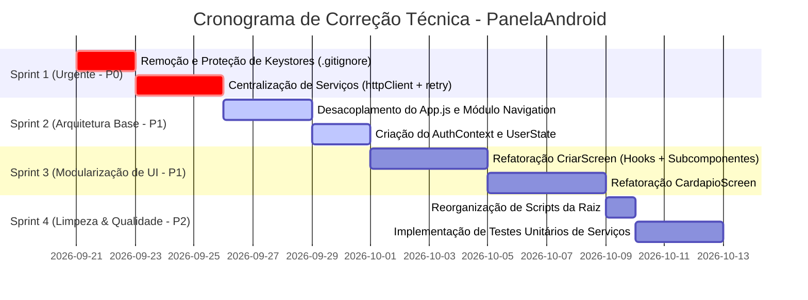

# Relatório de Auditoria Técnica e Plano de Refatoração
**Projeto:** Panela de Sobra (`PanelaAndroid`)  
**Data:** 20/09/2026  
**Auditoria Realizada via:** Pipeline Automatizado de Análise Estrutural (JEV)  
**Objetivo:** Identificar gargalos de arquitetura, vulnerabilidades de segurança e débitos técnicos, fornecendo um plano acionável para o time de desenvolvimento.

---

## 1. Sumário Executivo

A auditoria arquitetural realizada no código do aplicativo **Panela de Sobra** identificou um produto funcional com boa riqueza de recursos, porém com **débito técnico acumulado em componentes monolíticos, centralização excessiva de estado e vulnerabilidades na gestão de credenciais de compilação**.

### Resumo das Notas de Qualidade (Escala 1.0 a 5.0):
| Dimensão Auditada | Nota | Nível de Risco | Responsável Recomendado |
|---|---|---|---|
| **Segurança & Credenciais** | **3.27** | 🔴 **CRÍTICO** | Segurança / DevOps |
| **Camada de Serviços & Rede** | **2.61** | 🔴 **CRÍTICO** | Backend / QA |
| **Ponto de Entrada (`App.js`)** | **3.26** | 🟠 **ALTO** | Frontend Architect |
| **Telas Monolíticas (Screens)** | **3.28** | 🟠 **ALTO** | Frontend Team |
| **Build & Configurações** | **3.19** | 🟡 **MÉDIO** | DevOps / Mobile Engineer |

---

## 2. Falhas Críticas & Ações Imediatas (Prioridade P0)

### 🔴 FALHA 1: Chaves Keystore de Produção Versionadas na Raiz do Projeto
* **Arquivos Afetados:**
  - `@paneladesobra__PanelaBuild.jks`
  - `@paneladesobra__PanelaBuild_OLD_1.jks`
* **Descrição do Problema:**
  As chaves criptográficas usadas para assinar o binário Android (APK/AAB) de publicação na Google Play Store estão salvas diretamente na raiz do código-fonte. Caso este repositório seja compartilhado, aberto ou comprometido, terceiros poderão assinar versões maliciosas do app com a identidade oficial da empresa.
* **Ações Corretivas Mandatórias:**
  - [ ] **1.1.** Adicionar imediatamente ao `.gitignore`:
    ```gitignore
    *.jks
    *.keystore
    *.p12
    ```
  - [ ] **1.2.** Mover as keystores para um cofre seguro (Bitwarden, 1Password ou segredos gerenciados do EAS Build: `eas credentials`).
  - [ ] **1.3.** Se o repositório já tiver histórico no GitHub/GitLab, purgar os arquivos do histórico via `git-filter-repo` ou `BFG Repo-Cleaner`.

---

### 🔴 FALHA 2: Ausência de Cliente HTTP Padronizado e Resiliência de Rede
* **Arquivos Afetados:**
  - `src/services/apiService.js` (7.2 KB)
  - `src/services/authService.js` (12.0 KB)
  - `src/services/receitaService.js` (10.5 KB)
* **Descrição do Problema:**
  Esta camada obteve a **menor nota de todo o aplicativo (2.61 / 5.00)**, com 46,7% de probabilidade concentrada em falhas de qualidade. Os serviços realizam chamadas com blocos `try/catch` dispersos, sem tratamento padronizado de envelopes de erro, sem política de retentativa (*retry*) para conexões instáveis de internet móvel e sem interceptors para renovação transparente de tokens JWT/Firebase.
* **Ações Corretivas Mandatórias:**
  - [ ] **2.1.** Criar um cliente base unificado `src/services/httpClient.js` configurado com Axios/Fetch padronizado:
    - Base URL e timeout global (ex.: 15 segundos).
    - Request interceptor injetando automaticamente o `Authorization: Bearer <token>`.
    - Response interceptor capturando HTTP 401 para auto-refresh de sessão.
  - [ ] **2.2.** Padronizar todos os retornos de serviço em formato envelope:
    ```javascript
    // Padrão esperado para todos os serviços:
    return { success: true, data: result, error: null };
    // Em caso de falha:
    return { success: false, data: null, error: { code: 'NETWORK_TIMEOUT', message: '...' } };
    ```

---

## 3. Débitos Arquiteturais de Alto Impacto (Prioridade P1)

### 🟠 FALHA 3: Telas Monolíticas com Excesso de Responsabilidade (*God Screens*)
* **Arquivos Afetados:**
  - `src/screens/CriarScreen.js` — **80.3 KB** (~2.000 linhas)
  - `src/screens/CardapioScreen.js` — **73.3 KB** (~1.700 linhas, linhas 190 a 1709)
  - `src/screens/PerfilScreen.js` — **57.3 KB**
  - `src/screens/ExplorarScreen.js` — **51.7 KB**
* **Descrição do Problema:**
  As telas principais do aplicativo concentram, no mesmo arquivo:
  1. Renderização visual JSX massiva.
  2. Chamadas diretas de API e regras de negócio.
  3. Dezenas de estados locais soltos (`useState`) e efeitos de ciclo de vida encadeados (`useEffect`).
  Isso inviabiliza a escrita de testes automatizados, causa re-renderizações desnecessárias de toda a tela e torna qualquer manutenção extremamente custosa.
* **Ações Corretivas:**
  - [ ] **3.1. Extração de Custom Hooks:** Mover toda a lógica de estado e carregamento de dados para hooks especializados em `src/hooks/`:
    - `useCardapioData.js` (busca dados do cardápio, paginação, loading, erros).
    - `useCriarReceitaForm.js` (validação de formulário, upload de imagens, submissão).
  - [ ] **3.2. Decomposição Visual:** Quebrar as telas em microcomponentes em `src/components/cardapio/` e `src/components/criar/`:
    - Componentes puramente visuais (*dumb components*) com limite de **150 a 200 linhas** por arquivo.

---

### 🟠 FALHA 4: `App.js` como "God Object" e Navegação Acoplada
* **Arquivos Afetados:**
  - `App.js` — **38.4 KB** (linhas 108 a 1058 concentradas no `AppContent`)
  - `src/contexts/AlertContext.js` (único contexto existente)
* **Descrição do Problema:**
  O arquivo raiz do app concentra mais de 900 linhas contendo regras de autenticação, deep linking, registro de notificações push, inicialização de listeners e rotas de navegação. Além disso, a ausência de contextos globais para Autenticação e Usuário força o uso de prop-drilling ou consultas redundantes ao Firestore em cada tela.
* **Ações Corretivas:**
  - [ ] **4.1. Isolar a Navegação:** Mover toda a árvore de `NavigationContainer` e pilhas de telas para `src/navigation/AppNavigator.js` e `src/navigation/BottomTabNavigator.js`.
  - [ ] **4.2. Criar `AuthContext`:** Criar `src/contexts/AuthContext.js` para disponibilizar o estado do usuário logado, permissões e status de assinatura globalmente via hook `useAuth()`.
  - [ ] **4.3. Reduzir o `App.js`:** O `App.js` deve apenas orquestrar os Providers essenciais e o Navigator raiz, tendo no máximo **60 a 80 linhas**.

---

## 4. Limpeza e Organização de Build (Prioridade P2)

### 🟡 FALHA 5: Poluição da Raiz do Repositório com Scripts Temporários
* **Arquivos Afetados:**
  - `copiar_colecao.js`, `deletar_agente_curadas.js`, `exportar_receitas_curadas.js`, `find_incompat.js`, `test_api_real.js`, `test_match.js`, `test_string.js`, `validar_playstore.ps1`.
* **Descrição do Problema:**
  Scripts utilitários de manutenção, migração de dados e testes avulsos estão soltos no diretório raiz do projeto, dificultando a navegação e aumentando o risco de execução acidental em ambientes errados.
* **Ações Corretivas:**
  - [ ] **5.1.** Criar a pasta `scripts/maintenance/` e mover todos os utilitários de Firestore/banco para lá.
  - [ ] **5.2.** Mover scripts de validação de build para `scripts/ci/`.
  - [ ] **5.3.** Registrar os comandos correspondentes na seção `"scripts"` do `package.json`.

---

## 5. Cronograma Recomendado de Sprints



---

## 6. Critérios de Aceite para Re-Auditoria

Após a conclusão das tarefas, a equipe técnica poderá submeter o código para nova rodada de auditoria no pipeline. A aprovação exigirá:
1. **Keystores ausentes** da árvore de arquivos rastreados pelo Git.
2. **Nenhuma tela com mais de 350 linhas** de código.
3. **`App.js` com menos de 100 linhas**.
4. **Nota da camada de serviços (`score`) superior a 4.0 / 5.0**.
