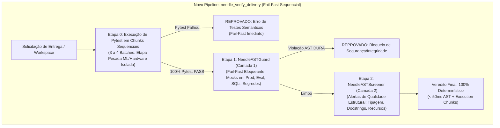

# Plano de Transição Arquitetural: Validação de Entrega 100% Determinística (`needle_verify_delivery`)

Este documento estabelece o plano oficial para a transição do pipeline de validação de entrega do ecossistema JEV, substituindo integralmente a antiga ferramenta probabilística `openjev_score_and_diagnose` pela nova suíte **100% determinística, veloz e sem limite de tokens** baseada em **Execução de Pytest em Chunks Sequenciais** + **Needle 3 (Camada 1 + Camada 2)**.

---

## 1. Diagnóstico do Pipeline de Validação Determinístico

### Principais Pilares da Transição
1. **Pytest em 1º Lugar (Fail-Fast):** Se os testes reais do repositório estiverem quebrados, a validação é abortada de imediato sem perder tempo processando AST.
2. **Execução em Chunks Sequenciais (3 a 4 Etapas):** Para não sobrecarregar a CPU e a GPU GTX 1050 Ti, a suíte de testes de `tests/` é repartida em 3 ou 4 chunks sequenciais. Os testes pesados (ML/PyTorch/Laya/Hardware) rodam em um chunk isolado.
3. **Substituição Total de `openjev_score_and_diagnose` por `needle_verify_delivery`:** Erradicação global da tool antiga em todo o ecossistema JEV, schemas e governança.
4. **Circuit Breaker Universal (Limite de 5 Tentativas):** Mantido o ciclo de até 5 tentativas. Se o código não for aprovado até a 4ª tentativa, a 5ª tentativa aciona automaticamente a **Saída de Emergência (Aprovação com Ressalva - `approved_with_caveat: true`)**.
5. **Sem Limite de Tokens & Fim do Gaming:** Zero dependência do Laya no gate de entrega. O Laya é focado estritamente em `openjev_choice` (roteamento/decisões probaiblísticas) e `openjev_consulta`.

---

## 2. As Camadas do Pipeline `needle_verify_delivery`

| Ordem | Camada | Mecanismo | Papel | Critério de Aprovação |
| :--- | :--- | :--- | :--- | :--- |
| **0** | **Validação Semântica Executável** | Pytest Chunk Runner | Executa a suíte `tests/` dividida em 3-4 chunks sequenciais (ML isolado). | 100% dos testes reais passando (exit code 0 em todos os chunks). |
| **1** | **Bloqueio de Segurança (Fail-Fast)** | `NeedleASTGuard` | Bloqueia violações graves e inegociáveis de segurança e integridade. | Zero violações de mocks em produção, segredos hardcoded, `eval()`, SQL Injection. |
| **2** | **Qualidade Estrutural (Screener)** | `NeedleASTScreener` | Analisa padrões de higiene de código, tratamento de exceções, tipagem e docstrings. | Relatório estruturado de alertas em formato `file:line` com sugestões. |

---

## 3. Fases de Execução da Transição

### Fase 1: Atualização dos Schemas Pydantic e AST Screener/Guard
- Refatorar `src/core/schemas.py`: remover `ScoreDiagnoseResponse` e criar `NeedleVerifyDeliveryRequest` e `NeedleVerifyDeliveryResponse`.
- Refinar `NeedleASTGuard` e `NeedleASTScreener` em `src/memory/` com suporte a supressões inteligentes (dunders, `@property`, stubs `.pyi`).

### Fase 2: Executor de Pytest em Chunks Sequenciais
- Criar `src/orchestrator/pytest_chunk_runner.py` para descobrir testes em `tests/`, categorizar em 3 ou 4 chunks sequenciais e isolar o chunk pesado (`test_laya_adapter`, `test_hardware`, `test_engine`, `test_score`).
- Garantir tempo limite (timeout) por chunk e coleta de logs de falha.

### Fase 3: Registro da Tool MCP `needle_verify_delivery` e Remoção do Legado
- Atualizar `src/mcp_server.py`: registrar a nova tool `needle_verify_delivery` e expurgar `openjev_score_and_diagnose`.
- Implementar a contagem de tentativas (1 a 5) com destravamento da Saída de Emergência na 5ª tentativa.

### Fase 4: Governança, Personas e Documentação
- Atualizar `AGENTS.md` (remover exigência de notas numéricas $\ge 3.40$ para entrega, estabelecendo `needle_verify_delivery` com 1º Pytest Chunks + 2º AST Guard + 3º AST Screener).
- Atualizar as personas (@Valério, @Túlio, @Maya, @Clara, @Otávio).

### Fase 5: Suíte de Regressão e Validação Final
- Criar `tests/test_needle_verify_delivery.py` para validar aprovações, bloqueios de AST, falhas de pytest em chunks e o Circuit Breaker na 5ª tentativa.

---

## 4. Matriz de Responsabilidades do Roster JEV

| Especialista | Atribuição na Transição |
| :--- | :--- |
| **@Valério (Lead Architect)** | Orquestração do pipeline, desenvolvimento da lógica de chunks e governança em `AGENTS.md`. |
| **@Maya (AST & Memory)** | Refino e auditoria das regras do `NeedleASTGuard` e `NeedleASTScreener`. |
| **@Túlio (MCP & Schemas)** | Atualização dos contratos Pydantic em `src/core/schemas.py` e exposição da tool MCP `needle_verify_delivery`. |
| **@Clara (QA & Anti-Mock)** | Criação da suíte de regressão `test_needle_verify_delivery.py` e auditoria de testes reais. |
| **@Otávio (Audit & Bridges)** | Atualização das referências de auditoria e bibliotecas cliente (`jev-client-bridge`). |
